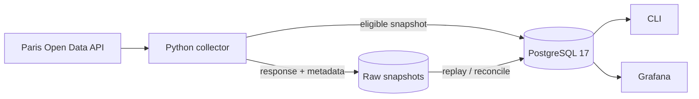

# Vélib' Data Lake

A compact, production-minded data pipeline for Vélib' station availability. It preserves every
raw API response, loads validated observations into PostgreSQL, and exposes pipeline health and
bicycle-availability metrics in Grafana.

The project answers one focused question:

> Among stations open for rental with a valid, recent observation, what proportion have no
> bicycles available?

## Run locally

Prerequisites: Python 3.12–3.14, [uv](https://docs.astral.sh/uv/), Docker Compose, and GNU Make.

```bash
make install
make dev-e2e
make dashboard-up
```

Then open <http://127.0.0.1:3000/d/velib-overview>.

`make dev-e2e` starts PostgreSQL, applies migrations, calls the live Vélib' API, stores the raw
snapshot under `./raw`, loads it into PostgreSQL, and prints the current indicator. The dashboard
command provisions Grafana against the same database.

Stop the local services with:

```bash
make dashboard-down
make dev-down
```

Defaults work without an environment file. To customize the source, storage, freshness, timeout,
or database settings, copy `.env.example` to `.env` and load it before running commands.

## Deploy to Azure

The deployment deliberately separates billable infrastructure creation from repeatable
application releases. There is no live deployment currently running.

### One-time setup

You need an Azure subscription, Azure CLI with Bicep, SSH/SCP, and `tar`. Authenticate and create
the deployment key:

```bash
az login
ssh-keygen -t ed25519 -f ~/.ssh/velib-dev -C velib-dev
```

Then choose one way to prepare the ignored parameter file.

Use the helper to detect and save the current public IPv4 before Azure resources exist:

```bash
make ssh-location SSH_LOCATION_ARGS="--add-current home --local-only"
```

This creates `infra/dev.local.parameters.json` from its template and fills `sshAllowedCidr`.
Alternatively, create and edit it manually:

```bash
cp infra/dev.local.parameters.json.example infra/dev.local.parameters.json
```

In either case, fill the remaining public-key and Azure user-object-ID placeholders. Review VM
availability, quota, and cost before provisioning. After the first deployment, `make ssh-location`
can update both this local file and the live Azure NSG when your address changes.

### Provision and deploy

After setup, the supported workflow is three steps:

1. Preview the infrastructure changes:

   ```bash
   az deployment sub what-if \
     --name velib-dev \
     --location francecentral \
     --template-file infra/main.bicep \
     --parameters @infra/dev.local.parameters.json
   ```

2. Explicitly create the reviewed resources:

   ```bash
   az deployment sub create \
     --name velib-dev \
     --location francecentral \
     --template-file infra/main.bicep \
     --parameters @infra/dev.local.parameters.json
   ```

3. Verify the VM's SSH host key, then deploy and verify the application:

   ```bash
   make vm-deploy
   ```

`make vm-deploy` discovers the VM and Blob endpoint, uploads only the required files, bootstraps
the host, migrates PostgreSQL, performs an initial collection, and verifies the timer and
indicator. It does not create Azure resources. Once infrastructure exists, application updates
normally require only `make vm-deploy`.

If your SSH source address changes later, run `make ssh-location` before deploying. The complete
[Azure VM runbook](docs/azure-vm.md) covers parameter values, host-key verification, VM sizing,
dashboard tunnelling, backup, restore, recovery, and safe teardown. Azure resources can incur
charges even when a VM is deallocated.

## What it demonstrates

- Raw-first ingestion with validation and retained failure evidence.
- Idempotent transformation and loading into PostgreSQL 17.
- Historical replay and bounded raw-to-SQL reconciliation.
- A dashboard-neutral SQL presentation layer and provisioned Grafana dashboard.
- Bicep infrastructure with managed identity, private Blob data, and restricted SSH.
- Collector locking, health semantics, operational logs, and tested disaster recovery.

## Architecture



Locally, raw snapshots are files and PostgreSQL runs in Docker. In Azure, a five-minute systemd
timer runs the collector on an Ubuntu VM, and private Blob Storage is the durable raw source of
truth. PostgreSQL is a rebuildable serving layer bound to VM loopback; a workstation dashboard
connects through an SSH tunnel.

See [Current architecture](docs/architecture/current-architecture.md) for the collection sequence,
data model, security boundaries, and failure behavior.

## Command reference

Run `make` to print the common workflow.

| Command | Purpose |
| --- | --- |
| `make install` | Install application and development dependencies |
| `make dev-e2e` | Run the local pipeline end to end |
| `make dashboard-up` | Start local PostgreSQL and Grafana |
| `make test` | Run the test suite |
| `make test-integration` | Run tests against local PostgreSQL |
| `make check` | Run Ruff lint checks |
| `make ssh-location` | Select and activate an allowed SSH source address |
| `make vm-deploy` | Release the application to existing Azure infrastructure |
| `uv run velib collections` | List collection attempts and inferred schedule gaps |
| `uv run velib backlog` | Compare eligible raw snapshots with processed SQL data |
| `uv run velib reconcile --limit 100` | Process the oldest missing snapshots |
| `uv run velib indicator` | Print the health-guarded current indicator |

Reprocessing is idempotent: `uv run velib process --collection-id <UUID>` loads one collection,
while `uv run velib process` performs a full replay of all eligible raw snapshots.

## Data safety and indicator semantics

Each collection writes `response.json` before its `metadata.json` commit marker. SQL processing
happens only after the raw snapshot is durable. A SQL failure therefore leaves recoverable source
evidence; reconciliation remains an explicit operator action.

For the indicator, invalid, closed, stale, and implausibly future-dated observations are excluded.
The remaining stations form the denominator, and stations with zero bicycles form the numerator.
A zero denominator or an outdated latest collection produces `null`, never a misleading zero.

See [Source API and data observations](docs/source-data.md) for source fields and assumptions, and
the [presentation-layer contract](docs/presentation-layer.md) for freshness and health semantics.

## Repository guide

```text
src/                 Python collector, storage, transformation, and CLI
migrations/          PostgreSQL tables and presentation views
dev/                 Local PostgreSQL and Grafana Compose files
infra/               Azure Bicep and VM bootstrap/runtime assets
scripts/             Deployment, SSH, and dashboard helpers
tests/               Unit, integration, and deployment-script tests
docs/                Architecture and operational documentation
```

Further reading:

- [Current architecture](docs/architecture/current-architecture.md)
- [Initial architecture decision](docs/architecture/0001-initial-vertical-slice.md)
- [Azure deployment and operations](docs/azure-vm.md)
- [Grafana dashboard](docs/dashboard.md)
- [Engineering handoff and improvement backlog](docs/architecture/engineering-handoff.md)

## Status and scope

The slice has been exercised locally and on Azure, including scheduled collection,
managed-identity Blob writes, private dashboard access, backlog reconciliation, VM reboot,
replacement-host recovery, and rebuilding PostgreSQL from retained raw data. The verification
resources were backed up and deleted on 2026-10-30, so this repository does not point to a live
demo.

Station reference data, geographic analysis, cloud-hosted visualization, automatic alerting, and
a general-purpose orchestrator remain outside the current scope.
